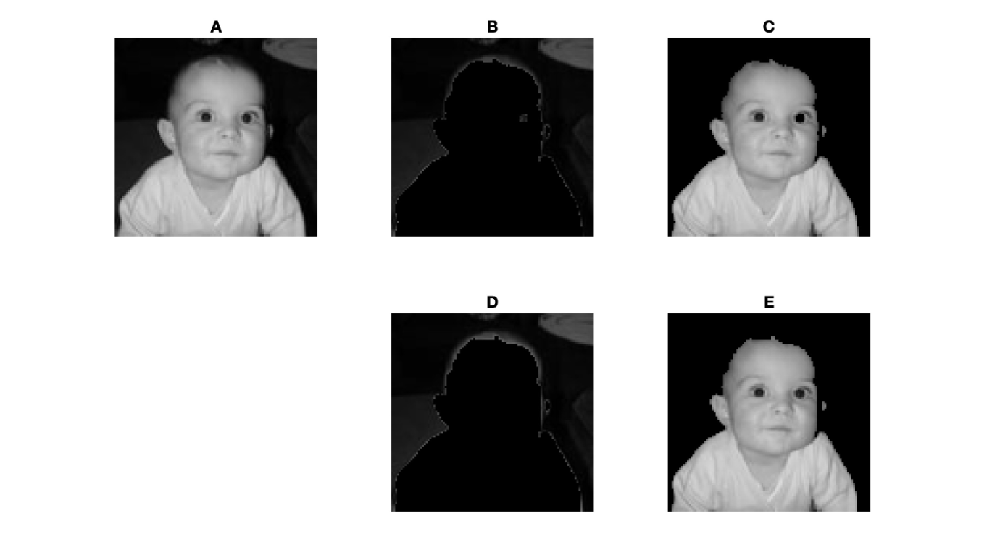
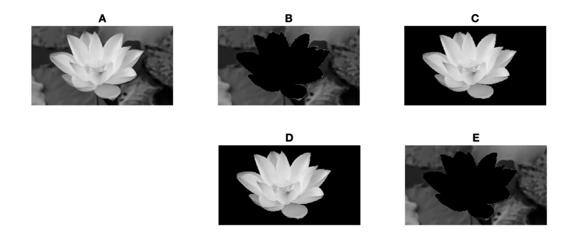
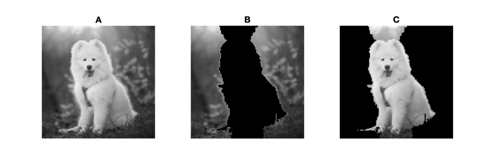

# Spectral Clustering and Image Segmentation

## Introduction

Any finite dataset can be transformed into an undirected, weighted graph by realizing each datapoint as a vertex and assigning an edge between every pair of vertices with a non-negative weight reflecting their degree of similarity. Through a systemic study of the matrix representation of this similarity graph, it is possible for us to find an optimal way to partition the graph such that the similarity within subgraphs are maximized while the disimilarity between them is respected. This technique is known as spectral clustering. We provide a practical application in image segmentation, where the main object of a gray-scale image can be detected and isolated. 

## Normalized Cut

Given a similarity graph $G$, we denote its vertex set by $V(G)$. Let $A, B$ partion $V(G)$, and we define $cut(A, B) = \sum_{i\in A, j\in B} \text{weight} (i, j)$, and $assoc(A, V(G)) = \sum_{i \in A, j \in V(G)}\text{weight} (i, j)$. Minimizing the normalized cut $$Ncut(A,B) = \frac{cut(A,B)}{assoc(A,V)} + \frac{cut(B,A)}{assoc(B, V)}$$ provides us with the optimal partition and it is attained by the eigenvector corresponding to the second smallest eigenvalue of $(\mathbf{D} - \mathbf{W})y = \lambda \mathbf{D} y$, where $\mathbf{D}$ is the diagonal matrix and $\mathbf{W}$ is the weight matrix of the matrix representation of $G$. 

## Construction of Similarity

We consider an extension of the Gaussian similarity function to represent similarity 
$$
    w_{ij} = \begin{cases} 
          e^{\frac{-\|F(i) - F(j)\|_2^2}{\sigma_I^2}} \cdot  e^{\frac{-\|X(i) - X(j)\|_2^2}{\sigma_X^2}} & \text{if} \quad \|X(i) - X(j)\|_2 < r \\
          0 & \text{otherwise}
       \end{cases}
$$

where $F$ is brightness level and $X$ is spatial location. $\sigma_I, \sigma_X, r$ are real parameters. This formulation reflects the intuition that, if two pixels are of small spatial proximity and have similar brightness values, then we admit a higher likelihood of them belonging to the same segment. 
We no longer concern the similarity between two pixels once their distance exceeds $r$. Lastly,$\{\sigma_I, \sigma_X\}$ controls the steepness of the function. 

## Experiment 1 

The following example showcases the results of standard spectral clustering with different choice of parameters. A is the original image. B, C correspond to one set of parameters while D, E correspond to another parameter set. 

Paramater setting for B, C:  $r = 11, \sigma _X = 8, \sigma_I = 17.85.\newline$ Parameter setting for D, E: $r = 7, \sigma_X = 5, \sigma_I = 25$.

## Experiment 2

The following example showcases the results of standard spectral clustering with different choice of parameters. A is the original image. B, C correspond to one set of parameters while D, E correspond to another parameter set. 

 
Parameter setting for B, C: $r = 11, \sigma _X = 8, \sigma_I = 17.85. \newline$ Parameter setting for D, E: $r = 8, \sigma_X = 7, \sigma_I = 13$.

## Experiment 3

The following example is of a special categories. Since the dog shares a similar brightness level with the backgroud, the algorithm is incapable of distinguishing it. Therefore, the standard spectral clustering technique and another density capture scheme are adopted. 

Parameter setting: $r = 11, \sigma _X = 8, \sigma_I = 17.85$.
## Selection of References

- J. B. Shi and J. Malik — *Normalized cuts and image segmentation,* IEEE Transactions on Pattern
Analysis and Machine Intelligence 22 (2000), no. 8, 888–905.

 - U. von Luxburg - *A tutorial on spectral clustering,* Statistics and Computing 17 (2007), no. 4,
395–416.

 - T. V. Le, C. A. Kulikowski, and I. B. Muchni, *A graph-based approach for image segmentation,*
Advances in visual computing, 2008, pp. 278–287.
